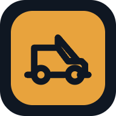
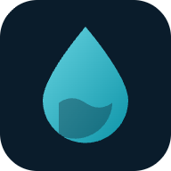
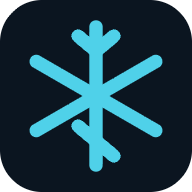
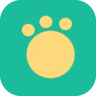

## Projects

<table>
<tr>
<td align="center" width="33%"><a href="https://github.com/chan-marcus/indiaclayoven"> <b>indiaclayoven</b></a> Restaurant&nbsp;ordering&nbsp;·&nbsp;SF</td>
<td align="center" width="33%"><a href="https://github.com/chan-marcus/ConsumerAutoBody"> <b>ConsumerAutoBody</b></a> Auto&nbsp;body&nbsp;shop&nbsp;·&nbsp;SF</td>
<td align="center" width="33%"><a href="https://github.com/chan-marcus/CONTYNT"> <b>CONTYNT</b></a> Creators&nbsp;×&nbsp;local&nbsp;businesses</td>
</tr>
<tr>
<td align="center" width="33%"><a href="https://github.com/chan-marcus/thecookiejeannie"> <b>thecookiejeannie</b></a> Small-batch&nbsp;cookies&nbsp;·&nbsp;SF</td>
<td align="center" width="33%"><a href="https://github.com/chan-marcus/wheelsourced"> <b>wheelsourced</b></a> Aftermarket&nbsp;wheel&nbsp;sourcing</td>
<td align="center" width="33%"><a href="https://github.com/chan-marcus/solanotowing"> <b>solanotowing</b></a> Towing&nbsp;·&nbsp;Fairfield,&nbsp;CA</td>
</tr>
<tr>
<td align="center" width="33%"><a href="https://github.com/chan-marcus/209restoration"> <b>209restoration</b></a> Water&nbsp;damage&nbsp;·&nbsp;Central&nbsp;Valley</td>
<td align="center" width="33%"><a href="https://github.com/chan-marcus/tylerfridgepro"> <b>tylerfridgepro</b></a> Refrigeration&nbsp;repair&nbsp;·&nbsp;Tyler,&nbsp;TX</td>
<td align="center" width="33%"><a href="https://github.com/chan-marcus/SJSU-PAC"> <b>SJSU-PAC</b></a> Pet&nbsp;adoption&nbsp;center&nbsp;·&nbsp;SJSU</td>
</tr>
</table>
